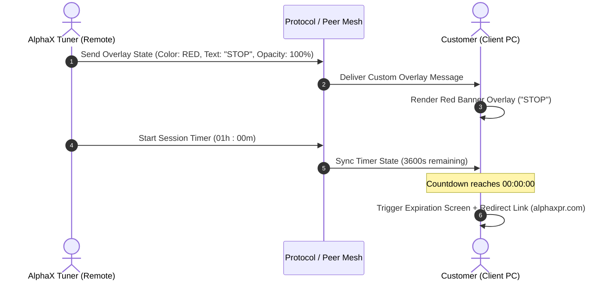

# AlphaX Desk Custom Tuning Suite — Implementation Plan & Technical Specification

> [!NOTE]
> **Project Goal**: Enhance **alphaX-desk** (custom RustDesk client) with specialized tools for AlphaX ECU tuners and remote customers. This includes custom AlphaX visual skinning/branding, a mandatory startup disclaimer, a remote traffic-light overlay system with opacity controls, two-way messaging, and a remote session timer with automatic payment link redirection.

---

## 1. Feasibility Assessment

| Feature Component | Feasibility Rating | Complexity | Primary Tech Stack |
| :--- | :---: | :---: | :--- |
| **AlphaX Custom Skinning & Branding** | **10 / 10** | Low | Flutter Theme Tokens & App Assets |
| **Startup Disclaimer Popup** | **10 / 10** | Low | Flutter UI (`main.dart` / modal dialog) |
| **Tuner Traffic Light & Text Overlay** | **9.5 / 10** | Medium | Flutter Window / Overlay + Custom Protocol |
| **Overlay Opacity Control** | **9 / 10** | Low-Medium | Flutter Opacity / Platform Window Alpha |
| **Two-Way Custom Text Box** | **10 / 10** | Low | Custom Protocol (`ChatMessage` extension) |
| **Session Timer & Limit Expired Lockout** | **9 / 10** | Medium | Rust/Flutter Timer state sync |
| **Overall Feasibility** | **9.5 / 10 (Very High)** | **Medium** | Built on existing RustDesk infrastructure |

---

## 2. Feature Specifications

### Feature A: AlphaX Custom Skinning & Visual Branding
- **AlphaX Design System & UI Theme**:
  - Custom dark theme color palette tailored to AlphaX brand aesthetic (sleek dark graphite background, metallic/crimson/neon accent highlights).
  - Modernized typography and custom button / card container styling across desktop and mobile screens.
- **Custom Application Icons & Assets**:
  - Replace all RustDesk default logos/icons with high-resolution AlphaX Desk logos across:
    - Desktop executable icons (Windows `.ico`, Linux `.png`, macOS `.icns`).
    - App window title bars and splash screens.
    - System tray icon and connection status notifications.
- **App Naming & Window Titles**:
  - Global branding rename from "RustDesk" to **"AlphaX Desk"** / **"AlphaX Remote Tuning"**.

---

### Feature B: Mandatory Client Startup Disclaimer
- **Trigger**: Every time the `alphaX-desk` application is launched on the client machine.
- **Behavior**:
  - Modal overlay disables main application functionality (remote connections blocked).
  - Displays formatted disclaimer text (e.g., liability release, tuning terms of service).
  - Contains an **"Accept & Continue"** button and an **"Exit"** button.
  - Connection capabilities remain locked until "Accept" is clicked.

---

### Feature C: Remote Tuner Overlay & Traffic Light System
- **Tuner Control Panel** (Remote Operator Side):
  - Added to the remote connection toolbar/drawer.
  - **Traffic Light Status Presets**:
    - 🔴 **RED**: Displays `"STOP"` (e.g., Turn off engine immediately / wait).
    - 🟡 **YELLOW**: Displays `"Tuning in progress"` (Do not touch laptop / wait for instructions).
    - 🟢 **GREEN**: Displays `"Please make a test run"` (Client ready to drive / log data).
  - **Custom Message Text Box**: Allows tuner to enter custom text broadcasted live onto the client's screen.
  - **Two-Way Chat Bar**: Allows client to respond or type back to tuner directly inside the overlay banner.

---

### Feature D: Overlay Opacity Controls
- **3 Opacity Modes** controllable by the Tuner:
  1. **Opaque (100% Solid)**: Covers client screen for clear visibility of traffic status / instructions.
  2. **70% Transparent / 30% Opaque**: Subtle overlay banner allowing the customer to watch ECU flashing/tuning software in the background.
  3. **No Overlay (0% / Hidden)**: Completely hides the status overlay.

---

### Feature E: Remote Session Timer & Expiration Redirect
- **Timer Setup (Tuner side)**:
  - Tuner sets duration in **Hours & Minutes** (e.g., `01h : 30m`).
  - Tuner controls: **Start**, **Pause**, **Reset**, **Stop**.
- **Live Sync**: Countdown timer is synchronized real-time on both the Tuner interface and Client overlay.
- **Session Expiration Lockout**:
  - When the countdown hits `00:00:00`:
  - Full-screen high-priority overlay appears on client machine:
    > **"SESSION TIME LIMIT EXPIRED"**
    > *To continue tuning services, please purchase additional hours.*
  - Prominent CTA Button / QR Code: **"Purchase Additional Hours"** opening:
    `https://alphaxpr.com/collections/tuning-service`

---

## 3. System Architecture & Protocol Design



### Protocol Extensions (`libs/hbb_common/protos/message.proto`)
Add custom message structures for overlay state & timer payload:

```protobuf
message TuningOverlayControl {
  enum OverlayColor {
    OFF = 0;
    RED = 1;      // "STOP"
    YELLOW = 2;   // "Tuning in progress"
    GREEN = 3;    // "Please make a test run"
    CUSTOM = 4;   // Custom message
  }
  
  enum OpacityMode {
    OPAQUE = 0;        // 100% solid
    SEMI_TRANSPARENT = 1; // 30% opaque / 70% transparent
    HIDDEN = 2;        // No overlay
  }

  OverlayColor color = 1;
  string custom_text = 2;
  OpacityMode opacity = 3;
  
  // Timer State
  uint32 timer_seconds_remaining = 4;
  bool timer_running = 5;
  bool session_expired = 6;
}
```

---

## 4. Codebase Integration Points in `alphaX-desk`

| Component | Target File Location | Function / Role |
| :--- | :--- | :--- |
| **AlphaX Branding & Skinning** | [`flutter/lib/common/theme.dart`](file:///home/normanpaulino/Documents/GitHub/alphaX-desk/flutter/lib/common/theme.dart) & [`flutter/assets/`](file:///home/normanpaulino/Documents/GitHub/alphaX-desk/flutter/assets) | Custom theme palette, logo replace, and brand styling |
| **Startup Disclaimer UI** | [`flutter/lib/common/widgets/disclaimer_dialog.dart`](file:///home/normanpaulino/Documents/GitHub/alphaX-desk/flutter/lib/main.dart) | Flutter modal window rendered on startup |
| **Custom Protocol Message** | [`libs/hbb_common/protos/message.proto`](file:///home/normanpaulino/Documents/GitHub/alphaX-desk/libs/hbb_common/protos/message.proto) | Define Protobuf schema for overlay & timer |
| **Tuner Control Panel** | [`flutter/lib/desktop/pages/remote_page.dart`](file:///home/normanpaulino/Documents/GitHub/alphaX-desk/flutter/lib/desktop/pages/remote_page.dart) | Add Tuner Toolbar Widget with traffic light controls |
| **Client Overlay Window** | [`flutter/lib/desktop/widgets/tuning_overlay.dart`](file:///home/normanpaulino/Documents/GitHub/alphaX-desk/flutter/lib/desktop/pages/desktop_home_page.dart) | Floating banner / Fullscreen timer expired overlay |
| **Timer Logic Sync** | [`src/server/connection.rs`](file:///home/normanpaulino/Documents/GitHub/alphaX-desk/src/server/connection.rs) | Relays timer ticks and state sync over peer connection |

---

## 5. Implementation Roadmap

### Phase 1: AlphaX Skinning & Startup Disclaimer
1. Update Flutter theme tokens (`theme.dart`) and replace app icons (`flutter/assets/`).
2. Update app strings and window titles to **AlphaX Desk**.
3. Create `DisclaimerDialog` in Flutter UI and enforce agreement on app startup.

### Phase 2: Remote Tuner Control & Overlay Infrastructure
1. Extend Protobuf schema with `TuningOverlayControl`.
2. Build Tuner Toolbar UI with Red, Yellow, Green status buttons, Custom Text input, and Opacity selector.
3. Build Client Overlay UI overlaying banner with live opacity adjustment.
4. Add two-way chat input box inside overlay.

### Phase 3: Remote Timer & Payment Redirect Expiration
1. Build Timer control panel widget for Tuner.
2. Implement backend countdown tick logic and sync via peer message.
3. Build Fullscreen "Session Time Limit Expired" modal with active URL link to `https://alphaxpr.com/collections/tuning-service`.

---

> [!TIP]
> **Next Actions**: The document has been saved directly to your project root as `ALPHAX_TUNING_SUITE_PLAN.md`. When you are ready to begin, we can start with Phase 1 (AlphaX Skinning & Disclaimer Modal).
